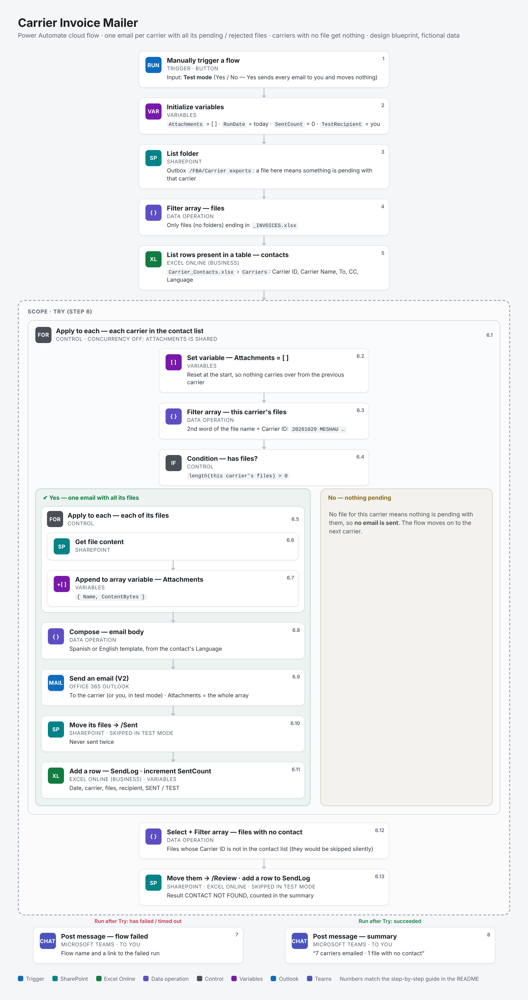

# Carrier Invoice Mailer (Power Automate)

A Power Automate cloud flow that sends **each carrier one email with all its open invoice files** (rejected and pending), finding the address in a contact list. A carrier with no file gets nothing: no file means nothing is pending with them.

It is the second half of a two-step process:

1. [**invoice-backup-splitter-vba**](https://github.com/farid-richa/invoice-backup-splitter-vba): an Excel macro writes one file per carrier and status, e.g. `20261029 MESHAU MESETA HAULAGE SA REJECTED_INVOICES.xlsx`
2. **This flow** picks those files up from a SharePoint folder and emails them to the right carrier.

> **This repository is a design blueprint**: the full flow, step by step, with every setting and expression needed to build it. The structure is the one I built and used at work; this design adds the improvements listed below. All carriers and addresses are fictional.



## How it works

The flow goes through the **contact list**, not through the files. For each carrier it collects every file that belongs to it into an attachments variable and, only if there is at least one, sends a single email with all of them. Then it moves on to the next carrier.

## What this design adds to the original

| Change | Why |
|---|---|
| Files matched by **Carrier ID** (2nd word of the file name) instead of "file name contains carrier name" | Similar names ("NORTHSTAR FREIGHT", "NORTHSTAR PARCEL") can no longer pick up each other's files |
| **Files with no contact** are detected after the loop, moved to /Review and logged | Otherwise a file for a carrier missing from the list just sits in the folder unnoticed |
| Attachments variable **reset at the start** of each carrier, loop **concurrency off** | If the loop ran in parallel, one carrier's files could end up in another carrier's email |
| Sent files moved to **/Sent** | A file can never be emailed twice |
| **SendLog** table | Date, carrier, files, recipient and result of every run |
| **Test mode** input | Every email goes to you first and no file is moved |
| **Spanish or English** template per carrier | Taken from the contact list |
| **Try / Catch** scopes | A Teams message if anything fails, a summary if it worked |

## Before you build it

- A **SharePoint** folder for the exports, e.g. `Shared Documents/FBA/Carrier exports`, with two subfolders: `Sent` and `Review`.
- [`samples/Carrier_Contacts.xlsx`](samples/Carrier_Contacts.xlsx) uploaded to the same site. It has two Excel tables: `Carriers` (the contact list) and `SendLog` (filled by the flow).
- Connectors, all standard: SharePoint, Excel Online (Business), Office 365 Outlook, Microsoft Teams.

## Step by step

Rename each action as shown in **bold** (⋯ → Rename). The expressions refer to actions by these names, with spaces written as `_`.

### 1 · Trigger: Manually trigger a flow
Add one **Yes/No** input named `Test mode`. In expressions it is `triggerBody()?['boolean']`.

### 2 · Initialize variable (×4)
| Name | Type | Value |
|---|---|---|
| `Attachments` | Array | `[]` |
| `RunDate` | String | `formatDateTime(convertFromUtc(utcNow(), 'Romance Standard Time'), 'yyyyMMdd')` |
| `SentCount` | Integer | `0` |
| `TestRecipient` | String | your own email address |

### 3 · SharePoint: List folder → **Exports**
- Site Address: your site
- File Identifier: `/Shared Documents/FBA/Carrier exports`

### 4 · Data operation: Filter array → **Files**
- From: `body('Exports')`
- Advanced mode:
```
@and(equals(item()?['IsFolder'], false), endsWith(toUpper(item()?['Name']), '_INVOICES.XLSX'))
```

### 5 · Excel Online (Business): List rows present in a table → **Contacts**
- Location: your site · Document Library: Documents · File: `/FBA/Carrier_Contacts.xlsx` · Table: `Carriers`

### 6 · Control: Scope → **Try**
Everything below goes inside this scope.

**6.1 · Apply to each → Each carrier**
- Select an output: `outputs('Contacts')?['body/value']`
- Settings: **Concurrency control off**. The `Attachments` variable is shared by every iteration.

**6.2 · Set variable**: `Attachments` = `[]`

**6.3 · Filter array → Carrier files**
- From: `body('Files')`
- Advanced mode:
```
@equals(toUpper(split(item()?['Name'], ' ')[1]), toUpper(trim(items('Each_carrier')?['Carrier ID'])))
```

**6.4 · Condition → Has files**: `length(body('Carrier_files'))` *is greater than* `0`

#### If yes

**6.5 · Apply to each → Each carrier file**: `body('Carrier_files')`

- **6.6 · SharePoint: Get file content → File content**. File Identifier: `items('Each_carrier_file')?['Id']`
- **6.7 · Append to array variable**: `Attachments`. Value:
```
{
  "Name": "@{items('Each_carrier_file')?['Name']}",
  "ContentBytes": "@{body('File_content')?['$content']}"
}
```

**6.8 · Select → File names**, then **Compose ×3 → Body EN, Body ES, Email body**
Templates and expressions in [`docs/email_templates.md`](docs/email_templates.md).

**6.9 · Office 365 Outlook: Send an email (V2)**
| Field | Value |
|---|---|
| To | `if(triggerBody()?['boolean'], variables('TestRecipient'), items('Each_carrier')?['To'])` |
| CC | `if(triggerBody()?['boolean'], '', items('Each_carrier')?['CC'])` |
| Subject | `concat(if(triggerBody()?['boolean'], '[TEST] ', ''), 'Open invoices - ', items('Each_carrier')?['Carrier Name'], ' - ', variables('RunDate'))` |
| Body | `outputs('Email_body')` |
| Attachments | *Switch to input entire array* → `variables('Attachments')` |

**6.10 · Condition → Not test mode** (`triggerBody()?['boolean']` *is equal to* `false`). Inside it:
Apply to each **Move each file** over `body('Carrier_files')` → SharePoint **Move file**: File to Move `items('Move_each_file')?['Id']` · Destination Folder `/Shared Documents/FBA/Carrier exports/Sent` · If another file is already there: *Copy with a new name*

**6.11 · Excel Online (Business): Add a row into a table** → `SendLog`, then **Increment variable** `SentCount` by 1
| Column | Value |
|---|---|
| Date | `variables('RunDate')` |
| Carrier ID | `items('Each_carrier')?['Carrier ID']` |
| Files | `join(body('File_names'), ', ')` |
| Sent To | same expression as **To** in 6.9 |
| Result | `if(triggerBody()?['boolean'], 'TEST', 'SENT')` |

#### If no
Nothing. No file means nothing is pending with this carrier.

**6.12 · Files with no contact** (after the loop, still inside **Try**)
- **Select → Contact IDs**. From `outputs('Contacts')?['body/value']`, map in text mode: `toUpper(trim(item()?['Carrier ID']))`
- **Filter array → Orphan files**. From `body('Files')`, advanced mode:
```
@not(contains(body('Contact_IDs'), toUpper(split(item()?['Name'], ' ')[1])))
```

**6.13 · Apply to each → Each orphan file** over `body('Orphan_files')`
- **Add a row into a table** → `SendLog`: Carrier ID `split(items('Each_orphan_file')?['Name'], ' ')[1]`, Files `items('Each_orphan_file')?['Name']`, Result `CONTACT NOT FOUND`
- **Condition → Not test mode**, inside: **Move file** to `/Shared Documents/FBA/Carrier exports/Review`

### 7 · Microsoft Teams: Post message in a chat or channel → **Alert failed**
- ⋯ → *Configure run after*: **Try** *has failed* and *has timed out* (untick *is successful*)
- Post as: Flow bot · Post in: Chat with Flow bot · Recipient: `variables('TestRecipient')`
- Message:
```
concat('Carrier Invoice Mailer failed. Run: https://make.powerautomate.com/environments/',
       workflow()?['tags']?['environmentName'], '/flows/', workflow()?['name'],
       '/runs/', workflow()?['run']?['name'])
```

### 8 · Microsoft Teams: Post message in a chat or channel → **Summary**
Runs after **Try** *is successful* (the default). Message:
```
concat(variables('SentCount'), ' carriers emailed · ', length(body('Orphan_files')), ' file(s) with no contact',
       if(triggerBody()?['boolean'], ' (TEST MODE)', ''))
```

## Try it with the sample files

1. In [invoice-backup-splitter-vba](https://github.com/farid-richa/invoice-backup-splitter-vba), run `ExportRejectedInvoices` and `ExportPendingInvoices`. They write 16 files: a rejected and a pending file for each of 8 carriers.
2. Upload them to the exports folder and run the flow with **Test mode = Yes**.
3. Expected:
   - **7 emails** in your own inbox, each with **2 attachments** (rejected and pending)
   - **2 rows** in `SendLog` marked `CONTACT NOT FOUND`, for both `NSTPAR` files (left out of the contact list on purpose)
   - A Teams summary: *7 carriers emailed · 2 file(s) with no contact (TEST MODE)*

## Limitations

- This is a design, not an export from a live environment. The actions and expressions use standard Power Automate syntax, but they have not been run end to end in this repository.
- The email does not include the invoice count or total. The flow would have to read the attached files, and Excel Online can only read files that contain a table.
- The file name format is a contract between the macro and the flow: the Carrier ID must be the second word.

## Files

```
docs/flow.png                  flow diagram
docs/email_templates.md        English and Spanish email templates
samples/Carrier_Contacts.xlsx  fictional contact list (table Carriers) and empty SendLog table
tools/flow_diagram.html        source of the diagram
tools/render_diagram.py        renders the diagram to PNG
tools/build_samples.py         builds the sample workbook
```

Built with AI assistance (Claude).
